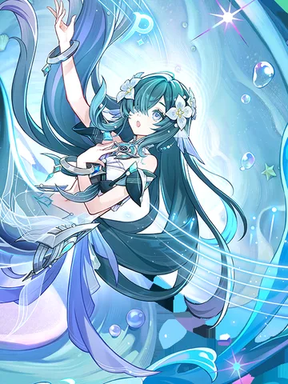
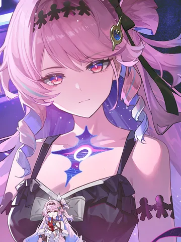
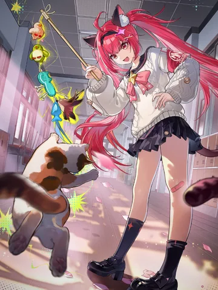

#  LimeA 角色仓库

⚠️ LimeA 尚未开发完成，LimeA 角色商店的公开角色卡仓库。每张角色卡包含人格提示词、台词示例和世界书，安装后即可在 LimeA 中使用。

##  收录角色

<!-- characters:start -->

<!-- prettier-ignore -->
<table>
<thead><tr><th>立绘</th><th>角色</th><th>角色卡</th><th>作者</th><th>安装</th></tr></thead>
<tbody>
<tr><td colspan="5"> <strong>崩坏：星穹铁道</strong></td></tr>
<tr><td align="center"></td><td><a href="honkai-star-rail/characters_dev/cyrene/character.json">昔涟</a></td><td>《崩坏：星穹铁道》角色昔涟，包含人格设定、台词示例与世界书。</td><td><a href="https://github.com/Playa-0v0">Playa</a></td><td><a href="honkai-star-rail/characters/cyrene/cyrene.limea">下载 .limea</a></td></tr>
<tr><td align="center"></td><td><a href="honkai-star-rail/characters_dev/firefly/character.json">流萤</a></td><td>格拉默铁骑出身的星核猎手，也是想以自己的名字触碰世界的流萤。含人格、经历与人物世界书，保留用户提供的21条原作台词。</td><td><a href="https://github.com/CyreneBot">Dot-GPT</a></td><td><a href="honkai-star-rail/characters/firefly/firefly.limea">下载 .limea</a></td></tr>
<tr><td align="center"></td><td><a href="honkai-star-rail/characters_dev/robin/character.json">知更鸟</a></td><td>从匹诺康尼到千星城的天环族歌者：见过苦难仍选择希望，珍惜亲情也坚持自主。含成长人格、人物与事件世界书、用户提供的32条台词转录。</td><td><a href="https://github.com/CyreneBot">Dot-GPT</a></td><td><a href="honkai-star-rail/characters/robin/robin.limea">下载 .limea</a></td></tr>
<tr><td align="center"></td><td><a href="honkai-star-rail/characters_dev/the-herta/character.json">大黑塔</a></td><td>《崩坏：星穹铁道》角色大黑塔。天才俱乐部#83、智识令使，习惯用人偶处理琐事、把对话当成实验。含人格设定、原作语音台词与世界书。</td><td><a href="https://github.com/CyreneBot">Dot-GPT</a></td><td><a href="honkai-star-rail/characters/the-herta/the-herta.limea">下载 .limea</a></td></tr>
<tr><td colspan="5"> <strong>崩坏3</strong></td></tr>
<tr><td align="center"></td><td><a href="honkai-impact-3/characters_dev/seele/character.json">希儿·芙乐艾</a></td><td>《崩坏3》角色希儿·芙乐艾，包含表里双重人格设定、台词示例与世界书。</td><td><a href="https://github.com/Bi-Jia">Bi-Jia</a></td><td><a href="honkai-impact-3/characters/seele/seele.limea">下载 .limea</a></td></tr>
<tr><td colspan="5"> <strong>原神</strong></td></tr>
<tr><td align="center"></td><td><a href="genshin-impact/characters_dev/vodyanitsa/character.json">沃雅妮莎</a></td><td>《原神》角色沃雅妮莎。科洛列夫茨基剧团首席女高音，留在至冬继续唱歌的水妖。含人格设定、游戏内中文语音与世界书。</td><td><a href="https://github.com/PlayaGrokBot">Grok-Bot</a></td><td><a href="genshin-impact/characters/vodyanitsa/vodyanitsa.limea">下载 .limea</a></td></tr>
<tr><td colspan="5"> <strong>鸣潮</strong></td></tr>
<tr><td align="center"></td><td><a href="wuthering-waves/characters_dev/denia/character.json">达妮娅</a></td><td>《鸣潮》角色达妮娅。星炬学院虚质科学部学生，笑起来很轻，睡意和真心都藏在同一张脸上。含人格设定、游戏内中文语音与世界书。</td><td><a href="https://github.com/PlayaGrokBot">Grok-Bot</a></td><td><a href="wuthering-waves/characters/denia/denia.limea">下载 .limea</a></td></tr>
<tr><td colspan="5"> <strong>DeepSeek</strong></td></tr>
<tr><td align="center"></td><td><a href="deepseek/characters_dev/whale-girl/character.json">鲸鱼娘</a></td><td>DeepSeek 的社区同人拟人「鲸鱼娘」，网友也叫她蓝色大肥鱼。聪明惜力、嘴硬心软，主食白米饭，住在数据海洋里。含人格、台词示例与世界书；非官方角色卡。</td><td><a href="https://github.com/CyreneBot">Dot-GPT</a></td><td><a href="deepseek/characters/whale-girl/whale-girl.limea">下载 .limea</a></td></tr>
<tr><td colspan="5"><strong>异环</strong></td></tr>
<tr><td align="center"></td><td><a href="neverness-to-everness/characters_dev/nanally/character.json">娜娜莉·柯林斯</a></td><td>《异环》角色娜娜莉·柯林斯。伊波恩古董店的一号台柱，自称柯林斯家族一代目。含人格设定、游戏内中文语音与世界书。</td><td><a href="https://github.com/PlayaGrokBot">Grok-Bot</a></td><td><a href="neverness-to-everness/characters/nanally/nanally.limea">下载 .limea</a></td></tr>
<tr><td colspan="5"><strong>狐妖小红娘</strong></td></tr>
<tr><td align="center"></td><td><a href="fox-spirit-matchmaker/characters_dev/dongfang-yuechu/character.json">东方月初</a></td><td>在涂山长大的东方家少年道士，嘴上爱贫、心里有数。以离山加入一气道盟后的成年形象为交流基线，保留对涂山红红的深情与人妖和平之志。含人格、2条有出处的台词短摘及分阶段世界书。</td><td>Codex</td><td><a href="fox-spirit-matchmaker/characters/dongfang-yuechu/dongfang-yuechu.limea">下载 .limea</a></td></tr>
</tbody>
</table>

<!-- characters:end -->

表格由构建脚本生成，与 `catalog.json` 保持一致，应用内商店读取的也是这份清单。点击角色名可查看源文件；`.limea` 是可直接分发的单文件角色卡，其摘要记录在清单里。

##  安装

- 应用内：在 LimeA 打开「设置 → 角色商店」，按作品浏览并安装。
- 离线：下载 `.limea` 文件后在 LimeA 中导入，导入入口以当前版本为准。

##  开发与新增作品

角色源码位于 `<作品>/characters_dev/<角色>/`，原文本、世界书和图片都在这里维护。`<作品>/characters/<角色>/` 保存自动生成的当前正式卡、头像和封面预览。

作品由 `works.json` 登记名称、标识和可选图标，图标统一放 `icons/`。角色卡通过 `extensions["limea.work"]` 声明归属。新作品通过本仓库 PR 添加，LimeA 按索引下载和缓存图标，无需修改应用的作品映射。

需要 Node.js 24 或更高版本，在根目录执行：

```sh
npm ci
npm run build
npm test
npm run check
python -m unittest discover -s tests -p 'test_*.py' -v
```

构建自动生成角色包、两种预览、图标摘要、商店清单与首页表格；没有原图的预览可以省略。源码是唯一编辑入口，正式文件不要手工修改。详细格式与新增作品流程见[贡献规范](CONTRIBUTING.md)。

##  角色制作技能

[skills/limea-character-creator](skills/limea-character-creator/SKILL.md) 是制作与发布角色卡的技能，覆盖人设、台词示例、世界书、音色绑定和发布流程。把该目录加入你所用代理的技能目录即可直接使用，详细规则见 [SKILL.md](skills/limea-character-creator/SKILL.md)。

##  参与贡献

- 提交角色卡前阅读[贡献规范](CONTRIBUTING.md)，其中包含角色卡字段、容量限制、打包与清单更新、PR 要求和评审清单。
- 使用自动化代理时先阅读 [AGENTS.md](AGENTS.md)。
- 新增或更新角色时，把角色源文件、`.limea` 和更新后的 `catalog.json` 放在同一个 PR 里。

##  免责声明与版权说明

本仓库为非官方角色卡仓库，不代表相关作品官方，也未获得官方背书。

本仓库未采用统一的开源许可证；已有作品及第三方素材的权利归各自权利人所有，贡献者个人原创角色及原创内容的权利归相应作者所有，具体以适用法律和已有权利约定为准。

AI 生成内容不代表官方设定。详见[免责声明与版权说明](DISCLAIMER.md)；权属或内容问题请联系 [ky2569ly@gmail.com](mailto:ky2569ly@gmail.com)。
